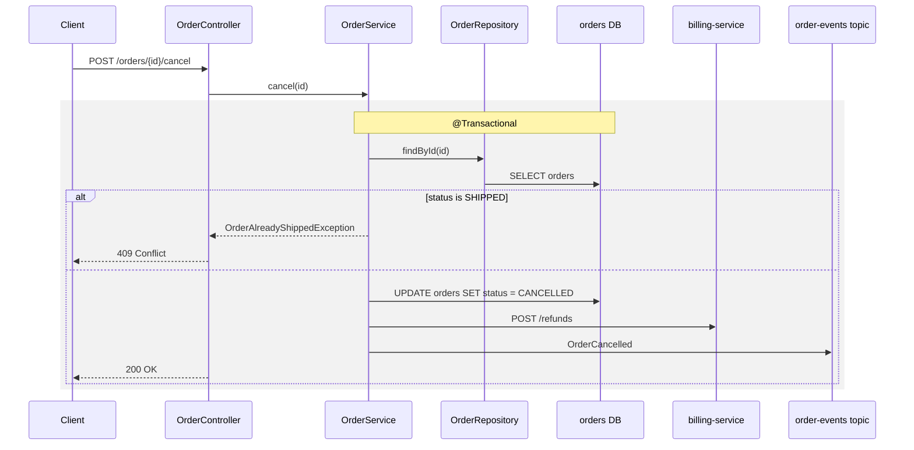

# ServiceMapAgent: a microservice map for VS Code GitHub Copilot

**Service Mapper** is a custom agent for GitHub Copilot in Visual Studio Code. It reads a code base made of many
microservices, in several layers, and writes a map of it as Markdown with Mermaid diagrams in `docs/service-map/`:

- **every endpoint of every service in one table**, instead of opening each service's Swagger page;
- **who calls whom**: a system diagram grouped by layer, and a table of which endpoint calls which endpoint of which
  service, plus the events and queues between them;
- **what each endpoint does**: for every endpoint that does more than load or save one record, a sequence diagram
  from the controller through the services and repositories down to the database tables, other services and topics,
  with the business branches, errors and the transaction boundary, and a step list linking to the code;
- **extras for a newcomer** (below): business journeys across services, data ownership, entity lifecycles, a
  glossary, and "things to know".

It never changes code, never builds or runs the application, and writes only inside `docs/service-map/`. Every fact
links to the `path:line` it came from, and what it couldn't prove is marked `❓`.

Written for the same custom agent format as [ReviewAgent](../ReviewAgent/)
([custom agents](https://code.visualstudio.com/docs/agent-customization/custom-agents)).

| File | What it is |
|------|------------|
| [`.github/agents/service-mapper.agent.md`](.github/agents/service-mapper.agent.md) | The agent: its tools and its instructions. |

CI checks it with ReviewAgent's [`scripts/check_agents.py`](../ReviewAgent/scripts/check_agents.py) `--may-edit`:
name and description present, known front matter keys and tools, and its edit tools limited to its own folder in the
instructions.

## The plan

A big code base doesn't fit in one agent's context, so the agent works **one service per run**, with a work list in
`docs/service-map/_progress.md` that survives between chats:

| Step | You say | It does |
|------|---------|---------|
| 1. Discover | `start` | Finds the services (build files, `@SpringBootApplication`, Dockerfiles, Helm, Terraform), sorts them into layers using your code base's own names, asks you once for what code can't tell (layer names, services to skip, the flows a newcomer should see first), and writes the work list and an empty skeleton. Services others depend on come first. |
| 2. Map | `next` (repeat), or a service name | Maps one service: endpoints (OpenAPI specs, Spring `@*Mapping`, FastAPI/Flask routes, gateway routes), outbound calls (Feign, `@HttpExchange`, `RestClient`/`RestTemplate`/`WebClient`, generated clients, resolved to the target service and endpoint through config, service DNS and Terraform), events (Kafka, Rabbit, SQS/SNS), data (JPA entities, `@Query`, native SQL, Flyway/Liquibase). Writes the service page and the endpoint pages, then adds its rows to the shared files. |
| 3. Journeys | `journey a customer places an order` | Follows one business flow across every service and event it touches, as one cross-service sequence diagram. |
| 4. Keep it fresh | `update` | `git diff` since the commit stored for each service, re-maps only what changed. |
| 5. Verify | `check` | Compares the map with the code and reports what drifted. |

Start a new chat every few services (the work list carries the state), and review each service page before moving on:
a wrong base URL early makes every caller's arrow wrong.

### What it writes

```
docs/service-map/
  README.md                       start here: what the system does, journeys, system diagram, layers, catalog
  endpoints.md                    every endpoint of every service: method, path, purpose, auth, link
  calls.md                        endpoint-to-endpoint calls, sync and async; events: topic, producers, consumers
  data.md                         tables, owning service, other services touching them
  glossary.md                     domain words, abbreviations, status values
  journeys/place-order.md         a business flow across services
  services/orders-service/README.md                what it is, neighbourhood diagram, endpoints, calls, data, lifecycles
  services/orders-service/POST-orders.md           one endpoint, step by step down to the database
  services/orders-service/POST-orders-id-cancel.md
  _progress.md                    the work list: service, layer, status, mapped at commit
```

An endpoint page looks like this:

````markdown
## POST /orders/{id}/cancel

Cancels an order that hasn't shipped, refunds the payment and frees the stock.



1. `OrderController.cancel` [OrderController.java:58](../../../orders-service/src/main/java/.../OrderController.java#L58)
2. ...
````

## Ideas for a first-time reader

Built into the agent, because they answer the questions a newcomer asks on day one:

- **Journeys first.** "What happens when a customer places an order" across services is the fastest way in; the map's
  README links them before anything else.
- **Layers as boxes.** The system diagram groups services by layer and shows one arrow per pair; details are one click
  away, so no diagram has more than about 25 nodes.
- **Data ownership.** Which service owns which table, and which services read another's tables directly (hidden
  coupling worth knowing before you change a column).
- **Entity lifecycles.** A state diagram per status field (`NEW → PAID → SHIPPED`, `→ CANCELLED`) with the endpoint or
  event that causes each transition.
- **Failure behaviour.** Timeouts, retries, circuit breakers and fallbacks on every remote call, and transactions that
  span a remote call.
- **Glossary** of domain words, abbreviations and status values.
- **Things to know** per service: shared tables, endpoints in the spec but not in code, feature flags, surprises.
- **Evidence and freshness.** `path:line` on every fact, `❓` on guesses, and the commit each page was mapped from.

Worth adding by hand (or asking the agent to draft from code): owners and contacts per service (the catalog has an
`owner` column for this), how to run a service locally, the main dashboards and alerts, and "where do I change X"
notes for the common tasks.

## Reading it

The map is plain Markdown and Mermaid, so it works offline and diffs in pull requests:

- **IntelliJ**: the built-in Markdown preview renders Mermaid (turn it on in Settings → Languages & Frameworks →
  Markdown if it asks).
- **VS Code**: the built-in Markdown preview shows the text; for the diagrams install
  [Markdown Preview Mermaid Support](https://marketplace.visualstudio.com/items?itemName=bierner.markdown-mermaid) if
  your version doesn't render them.
- **GitHub / GitLab** render Mermaid in Markdown files, so the map is browsable in the repository.
- **A searchable site**: [MkDocs Material](https://squidfunk.github.io/mkdocs-material/reference/diagrams/) turns the
  folder into a static site with search and Mermaid (`pip install mkdocs-material`, a 10-line `mkdocs.yml` with
  `pymdownx.superfences` and `docs_dir: docs/service-map`, then `mkdocs serve`); it can be published to an internal
  page later.

For trying endpoints, not reading about them: if the services already publish springdoc specs, one Swagger UI can
show all of them in a dropdown (`springdoc.swagger-ui.urls` on the gateway, or Swagger UI's `urls` option), so you
still don't need one page per service.

## Install

One self-contained file. From your project's root folder (or the folder that should hold the map):

```bash
mkdir -p .github/agents
curl -fsSL https://raw.githubusercontent.com/alexlol87/public_ish_projects/main/agents/ServiceMapAgent/.github/agents/service-mapper.agent.md \
  -o .github/agents/service-mapper.agent.md
```

On Windows (PowerShell):

```powershell
New-Item -ItemType Directory -Force .github/agents | Out-Null
Invoke-WebRequest https://raw.githubusercontent.com/alexlol87/public_ish_projects/main/agents/ServiceMapAgent/.github/agents/service-mapper.agent.md `
  -OutFile .github/agents/service-mapper.agent.md
```

Or save it to `~/.copilot/agents/service-mapper.agent.md` to have it in every project. With many repositories, open
them together as a multi-root workspace and tell it which one holds `docs/service-map/`.

Then turn on `github.copilot.chat.cli.customAgents.enabled` in VS Code user settings and check that **Service Mapper**
appears under Command Palette → **Chat: Open Customizations** → **Agents** (see
[`../../vscode_copilot_agents/`](../../vscode_copilot_agents/) for the rest of the setup). Pick it in the agent picker
and say `start`.

## Tools and permissions

`tools: ['read', 'search', 'execute', 'edit/createFile', 'edit/editFiles', 'todo', 'vscode/askQuestions']`

- `read` and `search` read the code, specs, config and Terraform.
- `execute` is limited by its instructions to read-only git (`rev-parse`, `log`, `diff --name-only`, `ls-files`), for
  the commit stamps and `update`. Keep terminal approvals on to see each command.
- `edit/createFile` and `edit/editFiles` write the map. The instructions limit them to `docs/service-map/`, and
  generated parts sit between `<!-- service-map:begin -->` markers, so your own notes outside them survive a re-run.
  Tool lists can't restrict paths; keep edit approvals on, or review the diff before you commit.
- No web, no MCP servers, no subagents: everything comes from the code on your machine.
