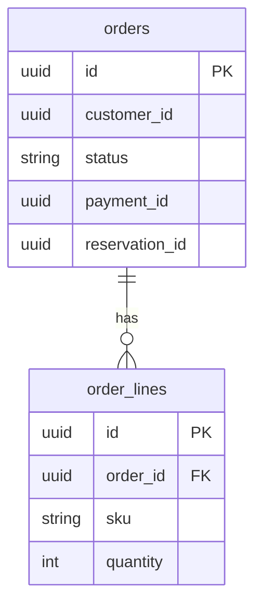

# Data

Each domain service owns one PostgreSQL database (Terraform `modules/rds`). No service reads another's tables.

| Table | Database | Owner | Written by | Read by |
|-------|----------|-------|------------|---------|
| `orders` | orders-db | orders-service | `POST /orders`, `POST /orders/{id}/cancel`, `shipment-events` listener | `GET /orders`, `GET /orders/{id}` |
| `order_lines` | orders-db | orders-service | `POST /orders` | `GET /orders/{id}` |
| `payments` | billing-db | billing-service | `POST /payments` | `GET /payments/{id}` |
| `refunds` | billing-db | billing-service | `POST /refunds`, `POST /refunds/partial` | — |
| `stock` | inventory-db | inventory-service | `order-events` listener | `GET /stock/{sku}` |
| `reservations` | inventory-db | inventory-service | `POST /stock/reservations`, `DELETE /stock/reservations/{id}` | expiry job |

## orders-db

