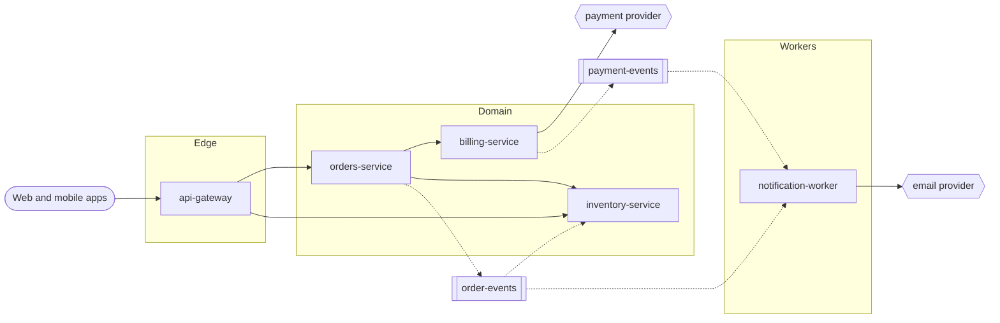

# Shop service map

!!! note "Demo"
    Everything here is a made-up shop, written by hand in the format the Service Mapper agent produces, so you can
    see how the map looks and works before running it on a real code base. In a real map every `File.java:42` is a
    link to that line of code.

**What the system does.** Customers browse products, check out a basket and get emails about their order. Five
repositories: an API gateway, three domain services (orders, billing, inventory) and a notification worker, deployed
on AWS by the `platform-infra` Terraform repository and GitHub Actions.

## How to read this map

1. Start with a **journey**: [Place an order](journeys/place-order.md) follows one business flow across every service.
2. Open the **[System graph](graph.md)** and click a service to see its endpoints and neighbours.
3. Look up any endpoint in **[All endpoints](endpoints.md)**, the one table that replaces each service's Swagger page.
4. Each service page has its endpoints, calls, events, data, and a step-by-step page for every endpoint that does
   more than read or save one record.
5. Use the search box (top right) for any endpoint path, table, topic or class name.

## System overview

Solid arrows are HTTP calls, dashed arrows Kafka events.

## Layers

| Layer | What lives here |
|-------|-----------------|
| Edge | Public entry points: authentication and routing, no business logic. |
| Domain | Business services, each owning its own database. |
| Workers | Event consumers with no HTTP API. |

## Service catalog

| Service | Layer | Purpose | Runs on | Owner |
|---------|-------|---------|---------|-------|
| [api-gateway](services/api-gateway/index.md) | Edge | Checks the JWT, routes `/api/**` | ECS Fargate | todo |
| [orders-service](services/orders-service/index.md) | Domain | Orders from checkout to delivery or cancellation | ECS Fargate | todo |
| [billing-service](services/billing-service/index.md) | Domain | Payments and refunds via the payment provider | ECS Fargate | todo |
| [inventory-service](services/inventory-service/index.md) | Domain | Stock levels and reservations | ECS Fargate | todo |
| [notification-worker](services/notification-worker/index.md) | Workers | Customer emails | AWS Lambda | todo |

## Open questions

- `billing-service` calls the payment provider with a 30 s timeout, longer than the gateway's 10 s: a slow payment
  shows the customer an error while the payment may still succeed. ❓ confirm with the team.

<small>Mapped from 6 repositories, see [Map progress](progress.md).</small>
