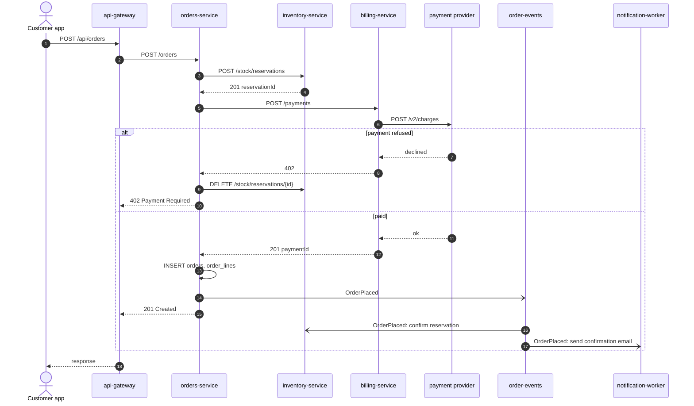

# Journey: a customer places an order

**The story.** The customer presses *Buy* in the app. The gateway checks who they are, orders-service holds the stock,
billing-service charges the card, and the order is saved. A Kafka event then lets inventory confirm the reservation
and the worker send the confirmation email. If the payment fails, the stock is released and nothing is saved.

| Step | Where | Details |
|------|-------|---------|
| 2 | api-gateway | route `orders`, [service](../services/api-gateway/index.md) |
| 3–12 | orders-service | [POST /orders](../services/orders-service/POST-orders.md) |
| 4 | inventory-service | [POST /stock/reservations](../services/inventory-service/index.md) |
| 6–7 | billing-service | [POST /payments](../services/billing-service/index.md) |

**What changes:** one row in `orders`, its `order_lines`, one `payments` row, the reservation becomes confirmed and
stock goes down, and the customer gets one email.

**When it goes wrong:** payment declined → 402 and the reservation is released. billing-service down → circuit
breaker opens, 503, reservation released. Gateway timeout (10 s) while billing waits on the provider (30 s) → the
customer sees an error but may still be charged ❓ see [open questions](../index.md#open-questions).
