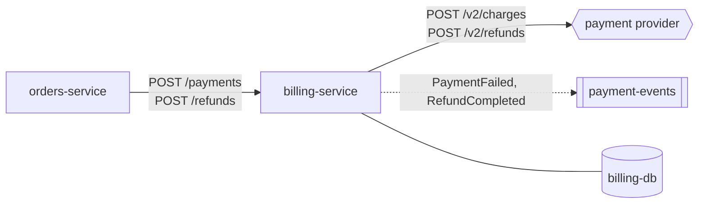

# billing-service

Takes payments and refunds through the external payment provider. **Layer:** Domain. **Tech:** Java 21, Spring Boot
3.4, `RestClient`. **Runs on** ECS Fargate (internal only).

| Method | Path | Use it when | Called by |
|--------|------|-------------|-----------|
| POST | `/payments` | Charging for an order; idempotent per `orderId` | orders-service |
| POST | `/refunds` | Full refund of a cancelled order | orders-service |
| POST | `/refunds/partial` | Refunding some lines (returns) | ❓ none found |
| GET | `/payments/{id}` | Support checks a payment at the provider | ❓ none found |

**Things to know:** the provider timeout is 30 s (`application.yml: provider.timeout`), longer than the gateway's 10 s.

<small>Mapped from `billing-service@c72be90` on 2026-10-23.</small>
