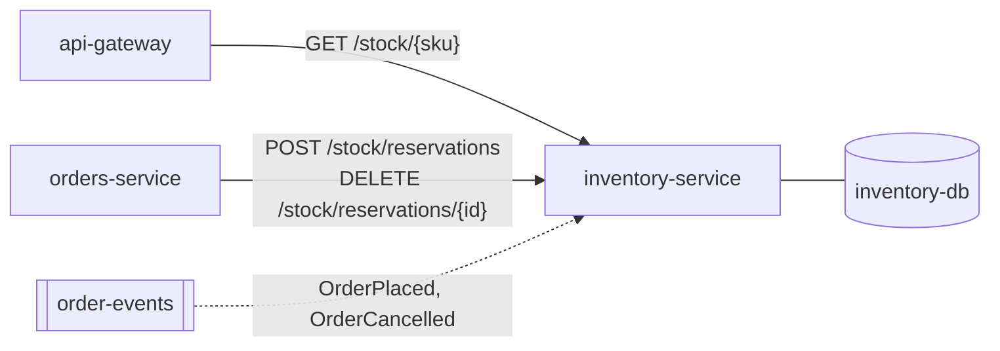

# inventory-service

Knows how much of each product is in stock and holds reservations for orders being placed. **Layer:** Domain.

| Method | Path | Use it when | Called by |
|--------|------|-------------|-----------|
| GET | `/stock/{sku}` | Showing availability on a product page | api-gateway |
| POST | `/stock/reservations` | Holding stock while an order is placed (expires in 15 min) | orders-service |
| DELETE | `/stock/reservations/{id}` | Releasing stock of a cancelled or failed order | orders-service |

**Other entry points:** `OrderEventsListener` confirms reservations on `OrderPlaced` and frees them on
`OrderCancelled`; `ReservationExpiryJob` (`@Scheduled`, every minute) frees expired ones.

<small>Mapped from `inventory-service@51d0e3a` on 2026-10-23.</small>
