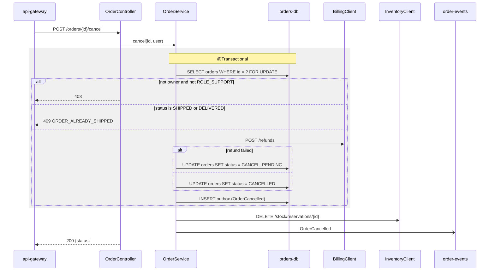

# POST /orders/{id}/cancel

**Use it when** a customer or support cancels an order that hasn't shipped yet. It refunds the full amount and frees
the stock. **Called by** api-gateway. **Not for** returns after delivery (those go through billing
`POST /refunds/partial`).

## Steps

1. `OrderController.cancel` — `OrderController.java:58`
2. Load and lock the order, check owner or `ROLE_SUPPORT` — `OrderService.java:80`
3. Refuse when shipped — `OrderService.java:84`
4. Refund through billing **inside the transaction** — `OrderService.java:88`
5. Free the stock (failure only logged) — `OrderService.java:97`

| Condition | Status | Error |
|-----------|--------|-------|
| Not the owner or support | 403 | `FORBIDDEN` |
| Unknown id | 404 | `ORDER_NOT_FOUND` |
| Already shipped | 409 | `ORDER_ALREADY_SHIPPED` |
