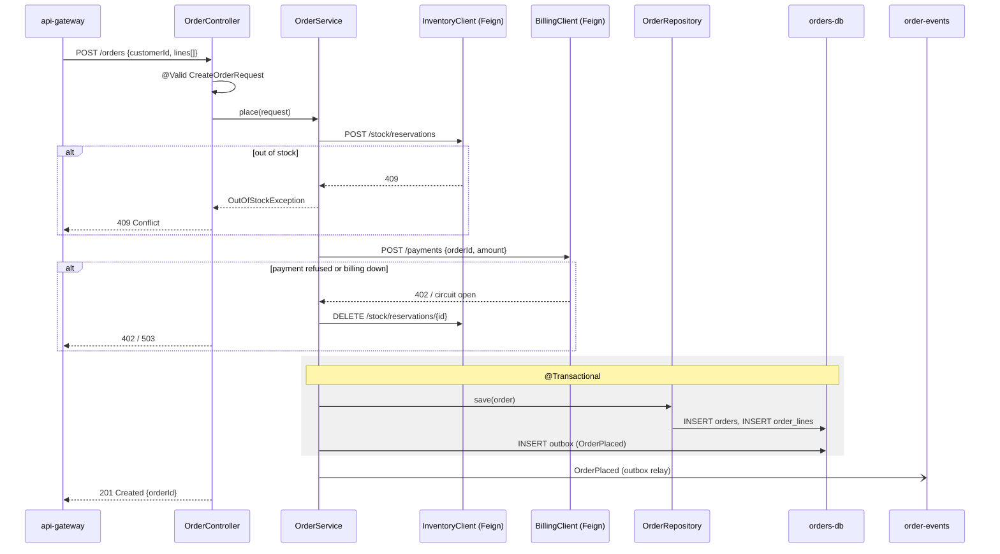

# POST /orders

**Use it when** a customer checks out a basket. It holds the stock, takes the payment and creates the order in one
call. **Called by** api-gateway (`POST /api/orders`). **Don't confuse with** `POST /stock/reservations`, which only
holds stock and creates no order.

## Steps

1. `OrderController.create` validates the body — `OrderController.java:52`
2. `OrderService.place` — `OrderService.java:40`
3. Reserve stock: `InventoryClient.reserve` → `inventory-service POST /stock/reservations` — `InventoryClient.java:18`
4. Charge: `BillingClient.charge` → `billing-service POST /payments`, Resilience4j `billing` breaker — `OrderService.java:51`
5. Save the order and the outbox row in one transaction — `OrderService.java:60`
6. `OutboxRelay` publishes `OrderPlaced` to `order-events` — `OutboxRelay.java:27`

## Validation and errors

| Condition | Status | Error |
|-----------|--------|-------|
| No lines, quantity < 1 | 400 | `VALIDATION_FAILED` with field list |
| A SKU is out of stock | 409 | `OUT_OF_STOCK` with the SKUs |
| Payment declined | 402 | `PAYMENT_DECLINED` |
| billing-service unavailable | 503 | `BILLING_UNAVAILABLE` |

**Side effects:** rows in `orders`, `order_lines`, `outbox`; a reservation in inventory; a payment in billing; event
`OrderPlaced`, which triggers the confirmation email.
