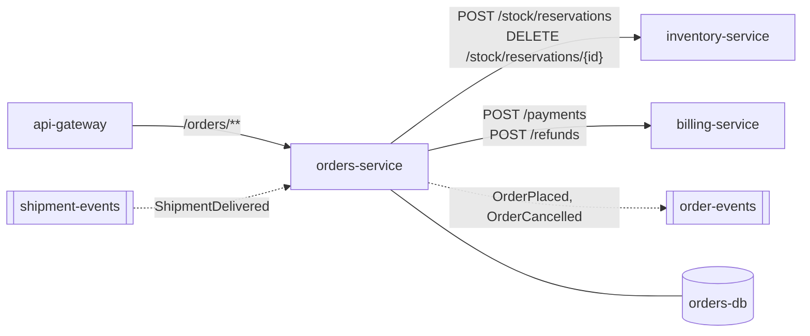
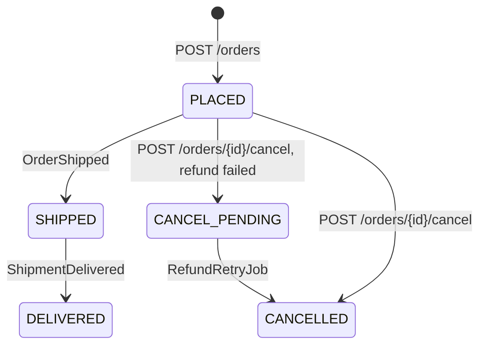

# orders-service

Owns orders, from the basket being checked out to delivery or cancellation. **Layer:** Domain. **Repository:**
`orders-service`. **Tech:** Java 21, Spring Boot 3.4, Spring Data JPA, Feign, Spring Kafka. **Runs on** ECS Fargate,
shipped by `deploy-orders.yml` (see [Infrastructure](../../infrastructure.md)).

## Neighbours

## Endpoints

| Method | Path | Use it when | Auth | Details |
|--------|------|-------------|------|---------|
| POST | `/orders` | Checking out a basket | `ROLE_CUSTOMER` | [flow](POST-orders.md) |
| GET | `/orders/{id}` | Showing one order | owner or `ROLE_SUPPORT` | `OrderController.java:41`, reads `orders`, `order_lines` |
| GET | `/orders` | Listing a customer's orders | `ROLE_CUSTOMER` | `OrderController.java:35`, paged, newest first |
| POST | `/orders/{id}/cancel` | Cancelling an order that hasn't shipped | owner or `ROLE_SUPPORT` | [flow](POST-orders-id-cancel.md) |

**Other entry points:** `ShipmentListener.onDelivered` (`@KafkaListener shipment-events`) sets status `DELIVERED`;
`RefundRetryJob` (`@Scheduled` every 5 min) retries refunds of `CANCEL_PENDING` orders.

## Order lifecycle

## Things to know

- The cancel flow calls billing **inside** the database transaction (`OrderService.java:88`): a slow refund holds the
  row lock.
- Releasing the reservation on cancel only logs a failure, so stock can stay reserved until it expires.

<small>Mapped from `orders-service@3f2a9c1` on 2026-10-23.</small>
